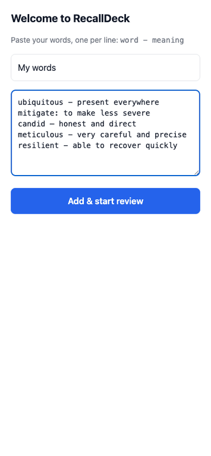
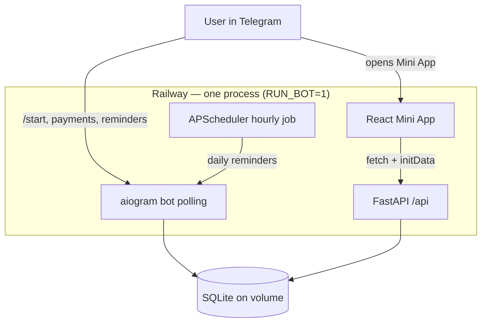

# RecallDeck

A dead-simple spaced-repetition vocabulary drill that lives **inside Telegram**. Paste a
list of words, get drilled once a day, keep a streak — nothing to configure, nothing to
install. Built for IELTS/English-exam learners and other deadline-driven vocabulary learners.

**Live bot:** [@RecallDeckAppBot](https://t.me/RecallDeckAppBot)

<p align="center">
  
</p>

## What it does

The whole product is one 60-second loop:

1. Open the bot, tap **Open RecallDeck** → the Mini App opens on an empty starter deck.
2. **Paste a list** (one pair per line, `word - meaning`) → cards are created instantly.
3. Tap **Review**, flip a card, grade it **Again / Good / Easy** → streak starts.
4. At **19:00 local** the bot pushes the cards due that day — come back, grade, streak grows.

## Features

- **Paste-a-list onboarding** — splits each line on a space-surrounded separator
  (`" - "`, `" — "`, `" – "`) or the first `":"`, so `well-known - famous` and
  `ratio: a:b relation` parse correctly. Manual add and CSV import are secondary paths.
- **SM-2 scheduling** — classic SuperMemo-2 (ease, interval, repetitions) collapsed to three
  grade buttons: `Again` (q=2, lapse), `Good` (q=4), `Easy` (q=5).
- **Daily reminder** — one hourly scheduler job pings each user at their local reminder hour
  (default 19:00, from the detected timezone) only when cards are due, never twice a day.
- **Streak** — consecutive days with ≥1 completed review, shown in the bot and the Mini App.
- **Stats** — due today, total cards, current streak, reviews this week.
- **Telegram Stars payments** — Free tier (2 decks / 60 cards); Premium monthly (Stars
  subscription) and yearly (one-time) unlock unlimited decks and cards.
- **Admin funnel** — `/stats` returns the per-source funnel (start → onboarding →
  first review → paywall → pay) plus D1/D7 retention for the last 14 days.

## Architecture

In production everything runs in **one Railway service / one process**: `uvicorn` serves the
Mini App API *and* the built frontend from the same origin (no CORS), and starts bot polling
plus the scheduler inside the FastAPI lifespan when `RUN_BOT=1`. SQLite is a single file on a
Railway volume.



Locally the two concerns run as separate processes so `--reload` never spawns a second poller
or duplicate scheduler jobs.

## Tech stack

| Layer | Tech |
|---|---|
| Bot | Python 3.12, aiogram 3 |
| API | FastAPI, SQLAlchemy 2 (async), SQLite + aiosqlite, Alembic (migrations on startup) |
| Scheduler | APScheduler (one hourly cron job) |
| Frontend | Vite + React + TypeScript + Tailwind + `@telegram-apps/sdk-react` |
| Payments | Telegram Stars (XTR) only |
| Deploy | Docker (multi-stage) on Railway |

## Security

- **initData validation on every API call** — the server runs
  `safe_parse_webapp_init_data(BOT_TOKEN, init_data)` and rejects on failure or when
  `auth_date` is older than 24 hours. The `user_id` is taken only from validated initData,
  never from the request body.
- **Idempotent payments** — a unique constraint on `telegram_payment_charge_id` makes
  re-applying the same charge a no-op.
- **Refunds** — `/refund <charge_id>` (admin only) calls `refundStarPayment`, cancels the
  Stars subscription for monthly plans, and shortens `premium_until` accordingly.
- **`/paysupport`** command is implemented (required for Stars).
- **Minimal data** — only Telegram `user_id`, settings, user-authored deck/card text, SM-2
  fields, streaks, `premium_until`, and payment idempotency keys are stored.

## Local development

```bash
# Backend API (Mini App API + static only; RUN_BOT unset)
cd backend
python -m venv .venv && . .venv/bin/activate
pip install -r requirements.txt
cp .env.example .env   # fill BOT_TOKEN, WEBAPP_URL, DATABASE_URL
uvicorn app.main:app --reload

# Bot + scheduler (the only poller/scheduler) — separate process
python -m app.bot_runner

# Frontend
cd frontend
npm install
npm run dev            # http://localhost:5173 (uses an in-memory mock when opened outside Telegram)

# Tests
cd backend && pytest
```

## Deploy (Railway)

One service, one volume, one process:

1. Create the Railway project from this GitHub repo and add a volume mounted at `/data`.
2. Set env vars: `BOT_TOKEN`, `WEBAPP_URL`, `DATABASE_URL=sqlite+aiosqlite:////data/recalldeck.db`,
   `SUPPORT_EMAIL`, `ADMIN_ID`, `RUN_BOT=1` (and optional `PRICE_MONTHLY` / `PRICE_YEARLY`).
3. Generate a domain, put it in `WEBAPP_URL`, and set the BotFather menu-button URL to match.
4. The `Dockerfile` builds the frontend and the Python image; Alembic migrations run on
   startup; `GET /health` backs the Railway health check; `railway.json` pins
   `numReplicas: 1` so there is exactly one poller and one scheduler.

## Pricing

| Plan | Price | Limits |
|---|---|---|
| Free | 0 | 2 decks / 60 cards, daily reminder, streak, stats, CSV import |
| Premium (monthly) | 199 ⭐ / 30 days (Stars subscription) | Unlimited decks & cards, custom reminder time |
| Premium (yearly) | 1,499 ⭐ one-time (extends access by 365 days) | Same Premium features |
